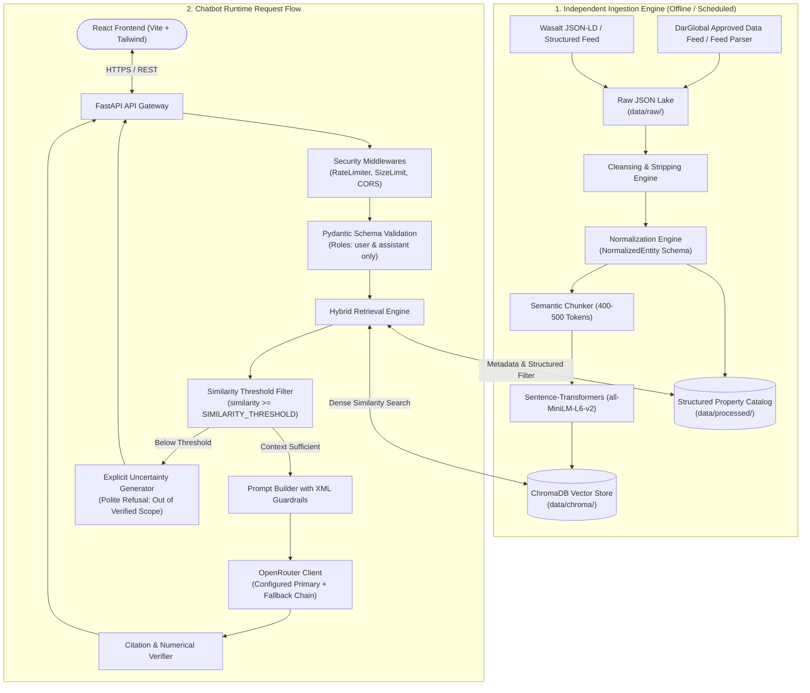

# System Architecture & Technical Specifications

## DarGlobal & Wasalt AI Real Estate Knowledge Assistant

---

## 1. Architectural Principles

The application is structured according to the following non-negotiable architectural mandates:

1. **Independent Scraper & Ingestion Lifecycle**:
   - The crawling and data ingestion engine is completely decoupled from the chatbot runtime.
   - The application **never** queries or scrapes external websites during a user query.
   - Knowledge is extracted offline, normalized, embedded, and indexed into persistent storage.
2. **Lawful, Permitted Ingestion & Access Controls**:
   - The system adheres strictly to website access policies and terms.
   - **No bypass mechanisms**: Imperva/Incapsula challenges, CAPTCHAs, or technical barriers are never evaded with stealth or adversarial techniques.
   - Data collection relies on permitted access methods, official feeds, and explicitly pre-supplied/verified structured datasets.
   - Source-specific ingestion is individually configurable via environment flags (`ENABLE_DARGLOBAL_INGESTION`, `ENABLE_WASALT_INGESTION`).
3. **Backend-Controlled Safety & Role Isolation**:
   - Inbound conversation payloads accept **only** `user` and `assistant` message roles.
   - System prompts, instructions, and guardrail rules are immutably controlled by the backend orchestration layer.
4. **Grounded Answers & Explicit Uncertainty**:
   - Responses are strictly grounded in retrieved vector snippets.
   - The system makes no unverified claims of "zero hallucinations"; instead, it enforces defensive prompt engineering, explicit uncertainty when data is missing or below relevance thresholds, and strict citation attribution.
5. **No Production Mock Fallbacks**:
   - When configured OpenRouter models are unavailable or encounter rate limits, the system does not substitute mock hallucinations. It returns a structured `503 Service Unavailable` error with a retry-after advisory.
6. **Calibrated Similarity Cutoff**:
   - Vector distance filtering uses a configurable similarity threshold (`SIMILARITY_THRESHOLD`), calibrated through rigorous evaluation suites.

---

## 2. High-Level System Architecture

---

## 3. Data Pipelines & Flow

### Ingestion Flow
1. **Source Access**: Verifies source enablement flag (`ENABLE_DARGLOBAL_INGESTION`, `ENABLE_WASALT_INGESTION`). Reads raw source data or lawful feeds.
2. **Raw Storage**: Persists unaltered payload in `data/raw/<source>/<hash>.json` with metadata (URL, timestamp, content type).
3. **Extraction & Sanitization**: Strips HTML tags, navigation cruft, script blocks, and extracts structured JSON-LD and meta tags.
4. **Normalization**: Maps domain entities to `NormalizedEntity` (categorized as `project`, `listing`, `company_info`, `faq`, etc.).
5. **Semantic Chunking**: Splits rich narrative text into 400-token semantic chunks with 50-token overlaps, prepending document title and category headers.
6. **Vector Indexing**: Computes 384-dimensional dense vectors using `all-MiniLM-L6-v2` and indexes into ChromaDB with metadata filters.

### Query Flow
1. **Request Intake**: Gateway validates `Content-Length <= 64KB` and enforces client IP rate limiting.
2. **Schema Verification**: Pydantic validates input. Any message containing `role: "system"` is immediately rejected with HTTP 422.
3. **Sanitization**: Null bytes and control characters are stripped.
4. **Hybrid Retrieval**: Queries ChromaDB with the user query, applying source and category filters if specified.
5. **Threshold Filter**: If the top retrieved cosine similarity is below `SIMILARITY_THRESHOLD`, the system bypasses the LLM and directly returns an uncertainty response with zero hallucinations.
6. **Prompt Assembly**: Retrieved chunks are wrapped inside `<untrusted_knowledge_context>` tags. The backend injects the fixed system prompt.
7. **Model Execution**: OpenRouter executes the prompt using `OPENROUTER_MODEL`. If the primary model fails with 5xx/429, the fallback models are attempted. If all fail, a `503 Service Unavailable` error is returned.
8. **Citation Verification**: Post-processing validates that returned citations match the retrieved documents.

---

## 4. Database & Storage Architecture

### Persistent Directory Map
- `data/raw/darglobal/`: Raw JSON records of DarGlobal properties, news, and company profile.
- `data/raw/wasalt/`: Raw JSON records of Wasalt listings and location guides.
- `data/processed/`: Normalized JSON catalog of verified properties and FAQs.
- `data/chroma/`: Persistent ChromaDB SQLite catalog and dense vector indices.

### Vector Collection Design
- **Collection Name**: `darglobal_knowledge`
- **Distance Metric**: Cosine (`hnsw:space: "cosine"`)
- **Metadata Fields**:
  - `source`: `"darglobal"` | `"wasalt"`
  - `category`: `"project"` | `"listing"` | `"company_info"` | `"faq"` | `"investment"`
  - `country`: e.g., `"United Arab Emirates"`, `"Saudi Arabia"`, `"Oman"`, `"United Kingdom"`
  - `city`: e.g., `"Dubai"`, `"Riyadh"`, `"Muscat"`, `"London"`
  - `property_type`: e.g., `"Villa"`, `"Apartment"`, `"Penthouse"`
  - `price_range`: e.g., `"under_1m"`, `"1m_to_5m"`, `"over_5m"`

---

## 5. Security Architecture

1. **Non-Root Containers**: Both backend (`appuser` UID 10001) and frontend (`nginx-unprivileged` UID 101) run without root privileges.
2. **Payload Protection**: Middleware rejects oversized payloads (`> 64KB`) with HTTP 413.
3. **Sliding-Window Rate Limiting**: Enforces max 60 requests/minute per client IP via `slowapi`.
4. **Prompt Injection Mitigation**: Web-scraped text is isolated inside XML delimiters and treated as untrusted data.
5. **CORS Allowlist**: Explicitly configured via `CORS_ORIGINS` in `.env`.

---

## 6. Controlled Multi-Model Fallback & Transparency

### Model Hierarchy
- **Priority 1 (Primary)**: `nvidia/nemotron-3-ultra-550b-a55b:free`
- **Priority 2 (Fallback 1)**: Configurable via `OPENROUTER_FALLBACK_MODELS` (e.g. `meta-llama/llama-3.3-70b-instruct:free`).
- **Priority 3 (Fallback 2)**: Configurable via `OPENROUTER_FALLBACK_MODELS` (e.g. `mistralai/mistral-7b-instruct:free`).
- Fallback routing is strictly controlled via `OPENROUTER_ALLOW_FALLBACK=true` (defaults to `false` to keep model locked).

### Eligible vs Ineligible Fallback Transitions
- **Eligible for Fallback**:
  - Model-specific HTTP 429 (transient concurrency or capacity limit on a specific model).
  - HTTP 500, 502, 503, 504 server errors.
  - Connection drop or socket timeouts.
- **Ineligible for Fallback (Immediate Termination)**:
  - Account-wide daily quota exhaustion (`free-models-per-day: 50 requests/day`): immediately raises rate limit error without trying fallbacks.
  - HTTP 401 (Authentication failure / invalid API key).
  - HTTP 402 (Credit quota or payment required).
  - HTTP 400 (Invalid request payload).
  - Application grounding, similarity, or numerical validation errors.

### Streaming Guardrails
- **Pre-Token Failure**: If a model fails before emitting its first token, the orchestrator safely attempts the next configured model in priority order.
- **Mid-Stream Failure**: If a failure or disconnect occurs after tokens have begun streaming to the client, the client **never** switches models or concatenates disjoint model outputs. The stream cleanly terminates with an error event.

### User Transparency & Attribution
- Every response (`ChatResponse` and SSE `citations` / `complete` events) carries the explicit `model` identifier that generated the tokens.
- The UI renders an unobtrusive model attribution badge in the assistant message header:
  - Primary model: `Nemotron 3 Ultra`
  - Fallback models: `Fallback: {modelName}` with subtle amber accent.
- Citations and property cards remain hidden until final validation passes, regardless of which model answered.
